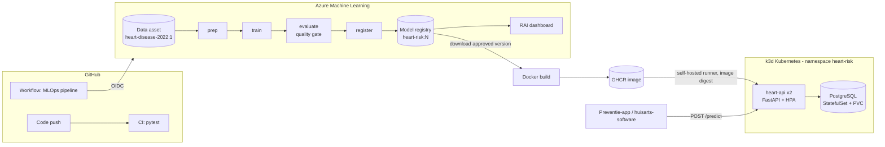

# Heart Risk MLOps — MLOps home project

Daan Hertveldt · MCT · MLOps 2026-2027

Een model dat op basis van een gezondheidsvragenlijst inschat hoe sterk iemands profiel lijkt op dat van mensen die een hartinfarct hadden. Het model wordt getraind in **Azure Machine Learning**, als **FastAPI** in **Docker** verpakt en uitgerold op **Kubernetes** (k3d) met een **PostgreSQL**-database. Alles is geautomatiseerd met **GitHub Actions**.

> Dit model is een statistische inschatting op basis van enquêtedata, **geen medische diagnose**.

## Data

[Personal Key Indicators of Heart Disease](https://www.kaggle.com/datasets/kamilpytlak/personal-key-indicators-of-heart-disease) (Kaggle, versie 2022). De data komt uit de jaarlijkse CDC BRFSS-telefoonenquête: 445.132 respondenten en 40 kolommen, waarvan 5,6 % een hartinfarct had (`HadHeartAttack`).

| Keuze | Waarom |
|---|---|
| `HadAngina` en `ChestScan` niet gebruikt | **Target leakage**: angina hoort bij coronaire hartziekte, en een scan volgt vaak *na* een infarct |
| `RaceEthnicityCategory` niet gebruikt als feature | Gevoelig kenmerk; enkel gebruikt om de **fairness** te controleren |
| Vaccins, HIV-test en COVID niet gebruikt | Geen plausibele risicofactor, maar een proxy voor zorggebruik |
| Ontbrekende waarden blijven NaN | LightGBM leert zelf wat "geen antwoord" betekent |
| Alle vragen verplicht in de API | In de enquête betekent "geen antwoord" gemiddeld een slechtere gezondheid (*informative missingness*) |

## Architectuur



## Mappenstructuur

```
src/heartrisk/        gedeelde code: feature contract, cleaning, model, SHAP  (pipeline EN API)
src/prep.py           component 1: opkuisen + gestratificeerde train/val/test split
src/train.py          component 2: baseline vs LightGBM, threshold tuning, MLflow-model + release.json
src/evaluate.py       component 3: test metrics, fairness audit, SHAP, quality gate
components/           Azure ML component-definities (code: ../../src)
environments/         Azure ML environment (Python 3.12, vaste versies)
computes/             compute cluster (schaalt naar 0)
pipelines/            Azure ML pipeline: prep -> train -> evaluate -> register
api/                  FastAPI + Dockerfile
k8s/                  Kubernetes manifests (API, PostgreSQL, HPA)
rai/                  Responsible AI dashboard (Azure ML SDK v2)
scripts/              eenmalige Azure-setup
tests/                pytest (draait in CI zonder Azure)
.github/workflows/    ci.yaml + mlops-pipeline.yaml
```

## De pipeline gebruiken

GitHub → Actions → **MLOps - Heart Risk pipeline** → Run workflow:

| Situatie | train | model_version | deploy | rai_dashboard |
|---|---|---|---|---|
| Nieuwe data of trainingscode → kandidaat-model | ✅ | – | ❌ | ✅ |
| Kandidaat goedgekeurd → live zetten | ❌ | nieuwe versie | ✅ | ❌ |
| Enkel API- of Kubernetes-code aangepast | ❌ | huidige versie | ✅ | ❌ |
| Snelle testrun tijdens ontwikkeling | ✅ (`sample_fraction` 0.1) | – | ❌ | ❌ |

Een getraind model gaat **nooit automatisch live**. Je bekijkt eerst de metrics, de fairness-audit en het RAI-dashboard, en pas daarna geef je het versienummer mee aan een deploy-run (manuele goedkeuring).

## API

Swagger: <http://localhost:30082/docs>

| Endpoint | Wat |
|---|---|
| `POST /predict` | Risico (0-1), niveau (low / elevated / high) en de top 5 SHAP-factoren. Wordt opgeslagen in PostgreSQL |
| `GET /predictions`, `/predictions/{id}` | Geschiedenis van de voorspellingen |
| `GET /predictions/stats` | Monitoring: aantal voorspellingen en risicoverdeling per modelversie |
| `GET /model/info` | Threshold, testmetrics, fairness-audit, globale feature-importance |
| `GET /version` | Lineage: modelversie, trainingscommit, datachecksum, API-commit, image digest |
| `GET /health`, `GET /ready` | Liveness en readiness probes voor Kubernetes |

## Lokaal ontwikkelen

```bash
python -m venv .venv && .venv/Scripts/pip install -r requirements-dev.txt
.venv/Scripts/python -m pytest                      # 15 tests, geen Azure nodig

# Volledige pipeline lokaal (dezelfde scripts als de Azure ML-componenten)
export PYTHONPATH=src
python src/prep.py --raw_data data/raw/heart_2022_with_nans.csv --train_data outputs/train --val_data outputs/val --test_data outputs/test
python src/train.py --train_data outputs/train --val_data outputs/val --model_output outputs/model
python src/evaluate.py --model_input outputs/model --test_data outputs/test --approved_model outputs/approved_model

# API in Docker met het lokale model
cp -r outputs/approved_model model
docker build -f api/Dockerfile -t heart-risk-api:local .
docker run -p 8000:8000 heart-risk-api:local       # http://localhost:8000/docs
```

De eenmalige setup (Azure, GitHub, runner, k3d) staat in [docs/SETUP.md](docs/SETUP.md).
